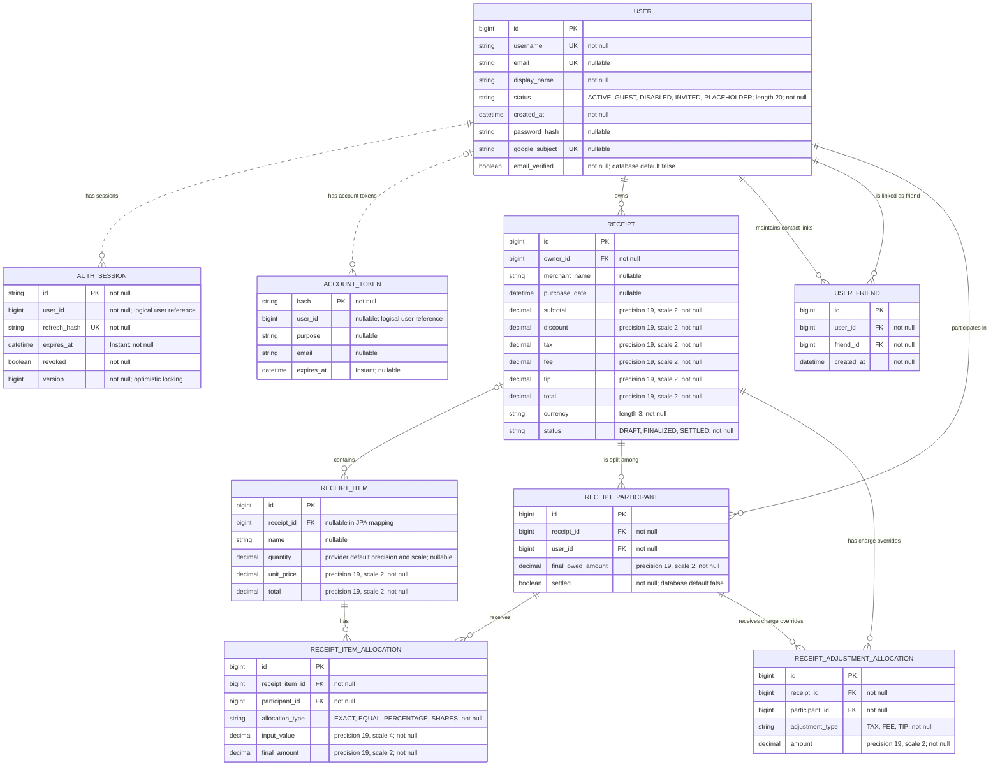

# Internal documentation

## Example .env configuration

Create a private `.env` in the repository root using this example. Replace the placeholders; do not commit the populated file. Spring Boot does **not** automatically load `.env` files.

```dotenv
# Local development. Change to prod for production schema validation.
SPRING_PROFILES_ACTIVE=default
DB_URL=jdbc:postgresql://localhost:5432/receipt
DB_USERNAME=receipt
DB_PASSWORD='replace-with-your-database-password'
AUTH_JWT_SECRET='replace-with-a-base64-key-of-at-least-32-random-bytes'
CORS_ALLOWED_ORIGIN=http://localhost:5173
SERVER_PORT=8080

# Optional Google sign-in
GOOGLE_CLIENT_ID=

# Optional email delivery (STARTTLS)
SPRING_MAIL_HOST=
SPRING_MAIL_PORT=587
SPRING_MAIL_USERNAME=
SPRING_MAIL_PASSWORD=
AUTH_MAIL_FROM=noreply@example.com
SPRING_MAIL_PROPERTIES_MAIL_SMTP_AUTH=true
SPRING_MAIL_PROPERTIES_MAIL_SMTP_STARTTLS_ENABLE=true
SPRING_MAIL_PROPERTIES_MAIL_SMTP_STARTTLS_REQUIRED=true
```

Generate the signing key once on Linux with `openssl rand -base64 32` and replace the placeholder. Keep the same key across restarts. Use the PowerShell key-generation instructions below on Windows. Configure SMTP and an authorized sender before enabling email features.

On Linux, load a trusted, shell-compatible `.env` into the current shell before starting:

```bash
set -a
source ./.env
set +a
./gradlew bootRun
```

Quote values containing spaces or shell-special characters. Sourcing a file executes shell code, so use only your own trusted configuration. On Windows, configure the values in your IDE's environment-variable settings or use the PowerShell `$env:` assignments documented below; PowerShell does not load this file automatically either.

For production, set `SPRING_PROFILES_ACTIVE=prod`, the real database connection, and the exact HTTPS frontend origin. Initialize or prepare the database as described in the deployment section before using schema validation.

Maintainer guide for the Receipt Split API. Covers implementation, configuration, build, tests, database behavior, and operation. Client-facing contracts are in [External documentation](EXTERNAL.md).

## Repository and architecture

Java 26 / Spring Boot 4.1.1 backend, Gradle wrapper, PostgreSQL at runtime, H2 in integration tests. No frontend, infrastructure provisioning, Docker configuration, or migration scripts are included.

- `src/main/java/com/cs/receipt/controller`: receipt and contact HTTP endpoints.
- `auth`: account endpoints, JWT/session validation, authorization interception, password/Google flows, rate limiting, and account tokens.
- `service`: receipt editing/lifecycle, exact split calculations, balances, and directional contacts.
- `dto`: validated requests and stable JSON responses. Map entities to DTOs; never serialize user credentials.
- `model` and `repository`: persisted receipt/user entities and Spring Data queries.
- `exception`: structured errors and HTTP status mapping.
- `src/main/resources`: default and production configuration.
- `src/test`: calculator, service integration, security, and HTTP contract tests.
- `postman`: runnable API collections; see verification instructions below.

The receipt owner is the payer. Non-owner final shares create debt to that owner. Balances are computed, per currency, from unpaid finalized shares; gross debt and informational offsets remain separate. Do not offset or sum across currencies. Persist `settled` on each participant rather than reducing original amounts. Finalization settles owner/zero shares; all participants settled makes the receipt SETTLED. Owner-only receipt unsettlement restores all external debts; it does not transfer money. Names come from users, not duplicated participant columns or friend-list lookups.

Receipt mutations acquire a pessimistic lock on the receipt. Bulk person settlement locks the owner's finalized receipts in ID order and operates transactionally. Preserve locking when changing lifecycle paths. Auth sessions use optimistic versioning. Display names are editable; usernames currently are not. Username/email lookup links existing accounts without creating duplicates; unknown usernames fail. Email invitations and name-only placeholders remain distinct from authenticating accounts.

## Data model

The diagram documents entity mappings and database nullability. Authentication user IDs are scalar logical references, not JPA foreign-key relationships. Hibernate schema update creates mapped structures; it does not backfill historical settlement state. Keep this diagram aligned with entities when fields change.



## Build, production configuration, and operation

This repository builds a standalone Spring Boot backend. It includes a production profile and does not include Docker, infrastructure provisioning, or database migration scripts. The frontend is hosted separately.

## Build and verify
Use Java 26 and the included Gradle wrapper from the repository root:

```powershell
.\gradlew.bat clean test bootJar
```

On Linux/macOS use `./gradlew clean test bootJar`. The executable artifact is `build/libs/receipt-0.0.1-SNAPSHOT.jar`. Use `bootJar`, not the plain JAR. Build on a machine with access to Gradle dependencies, then copy the artifact to a host with Java 26. Integration tests use H2 and mocked external providers; real PostgreSQL, SMTP, HTTPS, and Google credentials require the smoke checks below.

## Required runtime environment
Configure these through the host's service manager or secret store, not committed files:

| Variable | Value |
| --- | --- |
| `SPRING_PROFILES_ACTIVE` | `prod` |
| `DB_URL` | PostgreSQL JDBC URL, for example `jdbc:postgresql://db-host:5432/receipt` |
| `DB_USERNAME` | Database account with access to the application schema |
| `DB_PASSWORD` | Database password |
| `AUTH_JWT_SECRET` | Stable Base64 key containing at least 32 cryptographically random bytes |
| `CORS_ALLOWED_ORIGIN` | Exact frontend origin, such as `https://receipts.example.com` |
| `SERVER_PORT` | Optional; defaults to `8080` |
| `SERVER_ADDRESS` | Optional; set to `127.0.0.1` when a proxy runs on the same host |

The application does not load `.env` automatically. See [Provider setup](INTERNAL.md#local-development-and-provider-setup) for generating a signing key and SMTP/Google settings. Reuse the signing key across restarts. Do not use the test key. Configure database TLS according to the database provider's requirements and keep database access private.

The `prod` profile validates the schema, disables SQL logging and Swagger/OpenAPI, uses graceful shutdown, and hides exception details from default server errors. It does not add an Actuator health endpoint. Generic `/error` settings do not replace the application's structured API validation errors.

## First initialization of a new database
Create an empty PostgreSQL database and account before starting the application. A fresh database cannot pass schema validation. During the first controlled startup only, set:

```powershell
$env:SPRING_JPA_HIBERNATE_DDL_AUTO = 'update'
java -jar .\build\libs\receipt-0.0.1-SNAPSHOT.jar
```

The required environment above must already be present. Hibernate creates the mapped tables and constraints. Stop the process after successful initialization, remove the override, and start again with `prod` schema validation:

```powershell
Remove-Item Env:SPRING_JPA_HIBERNATE_DDL_AUTO
java -jar .\build\libs\receipt-0.0.1-SNAPSHOT.jar
```

Equivalent Linux first initialization: `SPRING_JPA_HIBERNATE_DDL_AUTO=update java -jar build/libs/receipt-0.0.1-SNAPSHOT.jar`; subsequent starts omit that override. Never use `create` or `create-drop` against persistent data. Hibernate-only schema creation does not create foreign keys for the scalar user IDs in authentication sessions/tokens; see [schema diagram](INTERNAL.md#data-model).

## Existing databases
Back up and verify the database before changing application versions. There are no migration scripts in this repository. Schema validation detects mismatches but does not upgrade or backfill data. Review the current entity mappings before enabling Hibernate update; it is not a historical data repair mechanism.

In particular, databases from before participant settlement need historical paid receipts and owner/zero shares reconciled with `receipt_participants.settled`; adding the column alone defaults it to false. Without reconciliation old finalized receipts may not automatically settle correctly. Existing users do not automatically receive passwords. An existing database is ready only after these data semantics are checked against its history. Do not silently run schema update on every production restart.

## Run the service
Use a service manager configured with Java 26, the required environment, a dedicated OS account, automatic restart, and persistent logs. Run `java -jar receipt-0.0.1-SNAPSHOT.jar` from the artifact directory. Keep database storage independent of application replacements. Stop with a normal termination signal so the 30-second graceful shutdown window can complete. Keep the previous artifact and a database backup for recovery; rolling back a JAR does not reverse schema/data changes.

Place the API behind HTTPS and restrict direct API access to the proxy/private network. The production profile ignores forwarded headers. The current IP rate limiter uses the socket peer address; a reverse proxy makes clients share that IP quota. Configure per-client rate limits at the gateway and verify behavior under expected traffic before launch. Simply enabling forwarded headers without a trusted proxy boundary is not sufficient. In-process account/email limits remain per instance; multiple instances need gateway coordination. Forward Authorization headers, preserve query parameters, and allow CORS preflight requests.

## Smoke checks
On the target backend, confirm:

1. Startup logs show the `prod` profile and successful schema validation, with no SQL query logging.
2. `GET /api/auth/me` without authentication returns 401.
3. `POST /api/auth/guest` returns a session; with its bearer token, `/api/auth/me`, `/api/receipts?userId=<guestId>`, and `/api/users/<guestId>/balances` work.
4. Another actor's ID is rejected with 403. The exact frontend origin passes preflight and authenticated requests.
5. On disposable test receipts, finalize, settle, unsettle, and refresh balances. Receipt participants include displayName and username. Add an existing person by username and email.
6. Verify real Google sign-in and SMTP delivery if enabled. Disable those frontend controls if the integrations are not configured.
7. Restart the process and confirm persisted accounts/receipts and refresh sessions still work.

Use [Postman verification](INTERNAL.md#postman-verification) against a disposable environment; complete runs create test data. Do not print or publish tokens. There is no public health-check endpoint; choose a TCP check or a dedicated authenticated probe.

Swagger and `/v3/api-docs` are intentionally disabled in production. To inspect routes in a controlled environment, explicitly set `SPRINGDOC_API_DOCS_ENABLED=true` and `SPRINGDOC_SWAGGER_UI_ENABLED=true`, then remove those overrides. The implementation includes `POST /api/receipts/{receiptId}/unsettle?userId=...`; see the full [external API contract](EXTERNAL.md).

## Verification boundary
A passing build confirms compilation, test coverage, and executable JAR packaging. This workspace has not verified a live host, production PostgreSQL, TLS/proxy, provider credentials, backups, or traffic limits. Complete the target-environment checks before launch.

## Local development and provider setup

## Requirements

- Java 26, PostgreSQL, and the included Gradle wrapper.
- Environment variables configured in the same terminal or IDE run configuration that launches Spring Boot. The app does not automatically load `.env` files.

## Required configuration

In PowerShell, set your database values:

```powershell
$env:DB_URL = 'jdbc:postgresql://localhost:5432/receipt'
$env:DB_USERNAME = 'your_database_user'
$env:DB_PASSWORD = 'your_database_password'
$env:CORS_ALLOWED_ORIGIN = 'http://localhost:5173'
```

Generate a JWT signing key once:

```powershell
$jwtBytes = New-Object byte[] 32
$rng = [System.Security.Cryptography.RandomNumberGenerator]::Create()
$rng.GetBytes($jwtBytes)
$rng.Dispose()
$env:AUTH_JWT_SECRET = [Convert]::ToBase64String($jwtBytes)
```

Save this value in your private IDE/deployment configuration and reuse it rather than regenerating on every launch. PowerShell `$env:` assignments apply to the current process and child processes; a new terminal will need configuration again. Do not commit secrets or put them in frontend environment variables. The Google client ID is public; signing keys and SMTP credentials are private.

Guest and password registration/login work with just the database and JWT settings.

## Google sign-in (optional)

Create a Web application OAuth client in Google Cloud and configure its branding/consent settings. Add the frontend origin (for local development, `http://localhost` and `http://localhost:5173`) to authorized JavaScript origins. Use the actual frontend port when different. Configure the same client ID in the frontend's Google Identity Services integration and the backend:

```powershell
$env:GOOGLE_CLIENT_ID = 'your-client-id.apps.googleusercontent.com'
```

This API verifies Google ID tokens and does not use a client secret or a backend OAuth callback. Obtain `/api/auth/google/nonce`, pass that nonce into Google Identity Services, and submit the returned ID token with the same nonce to `/api/auth/google`. Preserve the same guest bearer token across the nonce and exchange calls when upgrading a guest. See the [Google setup guide](https://developers.google.com/identity/gsi/web/guides/get-google-api-clientid) and [API flow](EXTERNAL.md).

## Email delivery (optional)

Use your email provider's SMTP host, port, credentials, and authorized sender. Example for a provider supporting STARTTLS on port 587:

```powershell
$env:SPRING_MAIL_HOST = 'your-smtp-host'
$env:SPRING_MAIL_PORT = '587'
$env:SPRING_MAIL_USERNAME = 'your-smtp-username'
$env:SPRING_MAIL_PASSWORD = 'your-smtp-password'
$env:AUTH_MAIL_FROM = 'verified-sender@your-domain.com'
$env:SPRING_MAIL_PROPERTIES_MAIL_SMTP_AUTH = 'true'
$env:SPRING_MAIL_PROPERTIES_MAIL_SMTP_STARTTLS_ENABLE = 'true'
$env:SPRING_MAIL_PROPERTIES_MAIL_SMTP_STARTTLS_REQUIRED = 'true'
```

Use an app password if your provider requires one. These settings assume STARTTLS; a provider requiring implicit TLS needs its corresponding Spring Mail SSL configuration instead.

After password registration, explicitly call `/api/auth/email/send-verification`. Messages contain a one-time token for entry into the frontend; the backend does not generate clickable frontend links. Password recovery sends mail only for active password accounts whose email has been verified. Missing provider configuration returns 503.

## Start and smoke-test

Start from the repository directory, using the configured terminal:

```powershell
.\gradlew.bat bootRun
```

In a second PowerShell terminal, create a guest and read its account:

```powershell
$apiBase = 'http://localhost:8080'
$guestSession = Invoke-RestMethod -Method Post -Uri "$apiBase/api/auth/guest"
$authHeaders = @{ Authorization = "Bearer $($guestSession.accessToken)" }
Invoke-RestMethod -Uri "$apiBase/api/auth/me" -Headers $authHeaders
Invoke-RestMethod -Uri "$apiBase/api/receipts?userId=$($guestSession.user.id)" -Headers $authHeaders
```

The account should have `status: GUEST`, and the receipt list should initially be empty. Use the returned `user.id` in receipt query parameters and friend paths. Supplying another actor's ID returns 403. Credentials are in `$guestSession`; avoid printing or sharing that object.

## Existing databases and troubleshooting

Local `ddl-auto=update` adds the current schema. Previously created users do not gain passwords automatically. Invited contacts cannot be claimed through password registration merely by matching their email.

- Startup fails on `AUTH_JWT_SECRET`: set a valid Base64 key containing at least 32 random bytes.
- 401: obtain a valid session or refresh without an expired Authorization header.
- 403: verify the actor ID matches the token and the account has permission on the receipt.
- 409 on guest upgrade: the username, email, or identity is already in use. No automatic account merge occurs.
- 429: wait before retrying; respect `Retry-After` when supplied.
- 503 from Google/email endpoints: check provider configuration and connectivity.

For the full endpoint list and session behavior, read [Authentication and account API](EXTERNAL.md#authentication-and-account-api).

## Production

Use the production configuration section above for packaging and the `prod` profile. Local defaults enable Hibernate schema update, SQL logging, and API documentation; production validates the schema and disables SQL logging/API documentation.

## Authentication implementation notes

Access tokens expire after 15 minutes; refresh sessions expire after 30 days. Refresh rotation consumes the old token, and bearer validation checks persisted session/account state so logout and deactivation revoke access immediately. Preserve guest user IDs during upgrades. Password changes/reset revoke sessions. Registration cannot claim invited/placeholder identities through an unverified email match. OAuth nonce and account token lifetimes and replay protections are part of the external contract.

Avoid logging credentials, refresh tokens, reset/verification tokens, or database passwords. Rate limits are bounded, in-memory, and per instance; the HTTP limiter uses the socket address. Proxy/shared gateway behavior requires target-environment verification.

## Postman verification

Import the desired `.postman_collection.json` file into Postman. Set **collection variables**, not environment variables with the same names; an active environment can override values captured by these collections. `baseUrl` defaults to `http://localhost:8080`.

Use a disposable development database. Account tests create records and deactivate their test account; deactivation does not erase users or placeholder contacts. Generated passwords and tokens are stored only in your local collection variables. Clear those values before exporting or sharing a run.

## Automated account and authentication tests

Import [accounts-auth.postman_collection.json](postman/accounts-auth.postman_collection.json) and run the **entire collection in order**, with one iteration. No Google or SMTP credentials are required. Each run generates a unique username, email, and passwords, and captures its own IDs and tokens.

The core suite contains 43 requests with 76 assertions. It covers both username and email sign-in. Google and email recovery require the manual provider steps below.

The collection verifies:

- Anonymous access denial, guest creation, and guest profile retrieval.
- Password validation and duplicate registration rejection.
- Guest registration preserves the user ID and an existing receipt, and revokes guest credentials.
- Case-insensitive username and email login, and incorrect-password rejection.
- Refresh rotation and rejection of a consumed refresh token.
- Single-session logout leaves another session usable; logout-all revokes both sessions.
- Display-name updates persist.
- Password change requires the current password, revokes sessions, and disables the old password.
- Contact creation/list/removal, receipt cleanup, and actor-ID authorization on receipt/contact routes.
- Account deactivation revokes access/refresh tokens and prevents login.
- Malformed bearer tokens are rejected and account responses exclude credential fields.

The collection includes a 2.2-second delay before each request to stay below the API's 30 auth requests/IP/minute limit. Allow about two minutes. Do not run other authentication collections concurrently from the same IP. A 429 after earlier manual traffic may require waiting a minute and restarting the collection from its first request. Do not disable rate limiting to run it.

For CLI use with Newman installed:

```powershell
newman run postman/accounts-auth.postman_collection.json
```

To target another development server, add `--env-var baseUrl=http://localhost:8080` with its address. This is an intentional override of the collection default; do not supply credential-variable overrides.

## Email verification and recovery (manual checkpoints)

Import [accounts-email-recovery.postman_collection.json](postman/accounts-email-recovery.postman_collection.json). Configure backend SMTP and set collection variable `recipientEmail` to a **fresh mailbox or alias you control**. A previously used email remains reserved even after account deactivation.

Run the numbered folders individually:

1. **Register and send verification**: creates a password account and sends a verification email. This folder clears old verification/reset tokens.
2. Copy the token from that email into collection variable `verificationToken`. Run **Verify email**: verifies it, rejects replay, checks the profile's verified flag, and requests a password reset.
3. Copy the reset email token into `resetToken`. Run **Reset password**: consumes the token, rejects replay, checks session revocation, verifies old/new password behavior, and deactivates the disposable account.

Do not run all folders unattended: the tokens must come from actual email delivery. Verification tokens expire after one hour and reset tokens after 15 minutes. Complete the verification folder while the initial access token is valid (15 minutes), or refresh it first. Missing SMTP configuration returns 503 and is a setup failure, not a passing verification test.

## Google sign-in (manual checkpoints)

Import [accounts-google.postman_collection.json](postman/accounts-google.postman_collection.json). Configure backend `GOOGLE_CLIENT_ID` and a Google Identity Services frontend using that same OAuth client ID.

1. Run **Guest and bound Google nonce**. It saves guest credentials and `googleNonce`.
2. Request a real Google Identity Services ID token using that exact nonce; use a test Google identity not already linked to an account in this database. Paste the returned credential into `googleIdToken`. An OAuth access token is not suitable.
3. Within five minutes of nonce creation, run **Exchange real Google credential**. It checks invalid-token rejection and guest-bound nonce enforcement, upgrades the guest without changing its ID, checks old guest access and nonce replay rejection, reads the linked profile, then logs out.

Do not run the whole collection unattended. If the nonce expires, request another nonce and obtain a new matching Google credential. Missing Google configuration returns 503; a Google identity already linked to another account returns 409 instead of upgrading a new guest. Neither counts as a passing upgrade test. The collection leaves the Google account active so it can be used for later sign-in; it does not delete or disable a real Google-linked account.

No provider credentials, fabricated verification tokens, or backend verification bypasses are bundled in these files.

## Receipt collections

[receipt-api.postman_collection.json](postman/receipt-api.postman_collection.json) exercises the receipt lifecycle. [bulk-draft-save.postman_collection.json](postman/bulk-draft-save.postman_collection.json) exercises atomic draft saves and rollback. Each obtains guest tokens before receipt requests. Run from the top with a development database; the lifecycle collection can leave settled receipts.

For server configuration and endpoint details, see [Local setup](INTERNAL.md#local-development-and-provider-setup) and [Authentication integration](EXTERNAL.md#authentication-and-account-api).

## Change and release checks

Run `./gradlew.bat clean test bootJar` (Windows) or `./gradlew clean test bootJar`. Inspect the executable JAR manifest and inclusion of the production profile. Verify documentation links and synchronize the external API guide when changing DTOs, validation, permissions, or routes. Integration tests do not verify a live production PostgreSQL database or provider credentials. Complete the deployment smoke checks before launch.

The two maintained documentation files are INTERNAL.md and EXTERNAL.md. Update them directly rather than creating parallel setup, handoff, or deployment guides.
